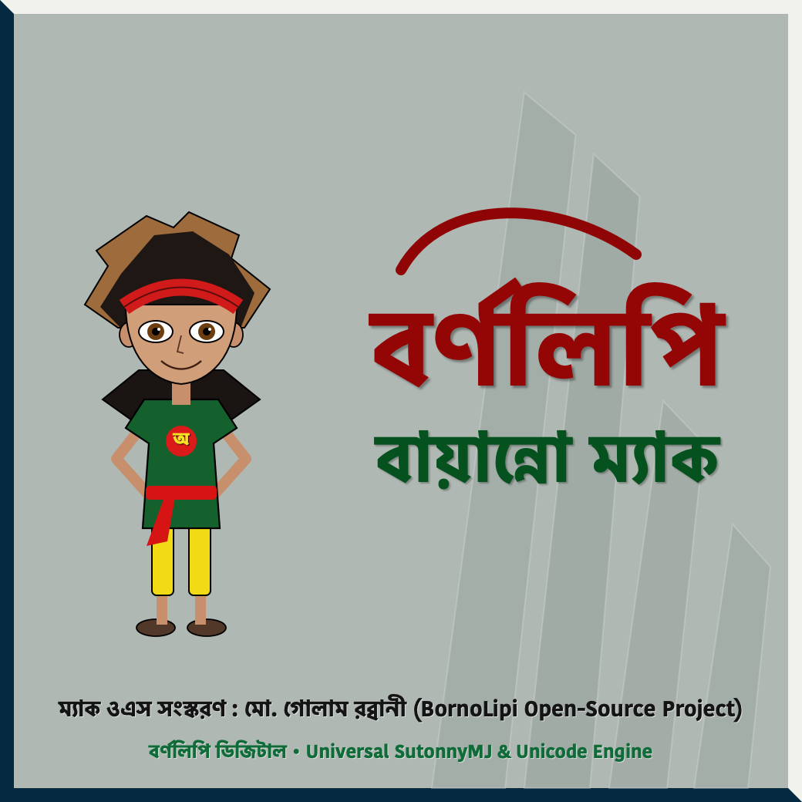

<p align="center">
  
</p>

<h1 align="center">বর্ণলিপি বায়ান্নো (BornoLipi) — Universal Bangla Keyboard for macOS</h1>

<p align="center">
  <b>Native macOS Bijoy Classic (<code>SutonnyMJ</code>) & Unicode Bangla Keyboard Engine</b><br/>
  Featuring a custom-crafted Metallic TopBar, Original Shaheed Minar Splash Canvas, 431 <code>&lt;Juk&gt;</code> Conjunct Engine, <code>F1</code> Keymap Overlay, and Bidirectional Converter Studio.
</p>

<p align="center">
  <a href="https://github.com/imgolamrabbani/BornoLipi/releases/latest">
    
  </a>
  <a href="https://github.com/imgolamrabbani/BornoLipi/releases/latest/download/Fonts.zip">
    
  </a>
</p>

<p align="center">
  
</p>

---

## ⚠️ Prerequisite: Install Bangla Fonts (`SutonnyMJ`) to `~/Library/Fonts/`

Before typing in **Bijoy Classic (`SutonnyMJ`)** mode inside **Microsoft Word**, **Pages**, or other macOS apps, you must install the classic Bangla ANSI/Unicode font pack (`SutonnyMJ`, `SutonnyOMJ`, `SushreeMJ`, `Kalpurush`, etc.) into your Mac's user fonts folder (`~/Library/Fonts/`):

### Option A — Manual Download & Paste
1. Download **[`Fonts.zip`](https://github.com/imgolamrabbani/BornoLipi/releases/latest/download/Fonts.zip)** (included in the repository root and on the [Releases](https://github.com/imgolamrabbani/BornoLipi/releases) page).
2. Extract `Fonts.zip`.
3. In Finder, press **`Cmd + Shift + G`**, type **`~/Library/Fonts/`**, and press **Enter**.
4. Copy and paste all `.ttf` / `.TTF` font files into **`~/Library/Fonts/`**.

### Option B — One-Line Terminal Command
```bash
mkdir -p ~/Library/Fonts && unzip -j -o Fonts.zip -d ~/Library/Fonts/
```
*(Note: If you run `make install` or `make fonts`, this is done for you automatically!)*

---

##  Quick Download (Pre-Built `BornoLipi.app` Release)

You don't even need to compile from source! Download the ready-to-run macOS app directly from **[GitHub Releases](https://github.com/imgolamrabbani/BornoLipi/releases/latest)**:

1. Download **[`BornoLipi-v2.0.0-macOS.zip`](https://github.com/imgolamrabbani/BornoLipi/releases/latest/download/BornoLipi-v2.0.0-macOS.zip)** and **[`Fonts.zip`](https://github.com/imgolamrabbani/BornoLipi/releases/latest/download/Fonts.zip)** from the latest release.
2. Extract and paste the fonts inside `Fonts.zip` into **`~/Library/Fonts/`**.
3. Extract `BornoLipi-v2.0.0-macOS.zip` and drag **`BornoLipi.app`** to your **`/Applications`** folder.
4. If macOS Gatekeeper shows an unverified developer prompt on first open, run:
   ```bash
   xattr -cr /Applications/BornoLipi.app
   open /Applications/BornoLipi.app
   ```
5. Grant **Accessibility Permission** in **System Settings → Privacy & Security → Accessibility** (toggle **`BornoLipi`** ON).

---

##  Key Features

- **Classic Metallic TopBar (`FloatingToolbarWindow`)**:
  - Inspired by the classic desktop Bangla keyboard bar—metallic dark-slate and emerald chassis with gold-bronze bevel trim, custom red-and-yellow **বর্ণলিপি বায়ান্নো** calligraphy wordmark (`topbar_wordmark.png`), custom mode emblems (`emblem_english.png`, `emblem_classic.png`, `emblem_unicode.png`), crisp white mode selector (`English` / `Bijoy Classic (SutonnyMJ)` / `Unicode (Bangla)`), tactile keyboard layout button, gear button, glossy status orb, and close button.
  - Built as a non-activating macOS `NSPanel` (`.nonactivatingPanel`) so switching modes or opening the keymap **never steals cursor focus from Microsoft Word**.
- **100% Authentic Bijoy Classic (`SutonnyMJ`) Engine**:
  - Driven by all **431 `<Juk>` conjunct & ligature rules** (`BijoyClassic.xml`), including contextual vowel sign positioning (`Ky -> Kz`, `K~ -> K‚`, `K„ -> K…`), word-initial `†`/`ˆ` variants (` ‡ -> †`), independent vowels via the link key `g` (`g+f -> Av`, `g+d -> B`, `g+c -> G`), and 2- and 3-consonant conjuncts (`ক্ষ`, `জ্ঞ`, `ন্ত্র`, `স্ত্র`, `দ্ধ`, `ঞ্চ`, etc.).
  - Supports typing `ি` (`d`), `ে` (`c`), and `ৈ` (`Shift+C`) **both before or after** the consonant!
- **Native Bijoy Unicode Engine (`Unicode.xml`)**:
  - Full support for `Delay` pre-base vowel signs (`ি`, `ে`, `ৈ`), `DeInc1`/`DeInc2` conjunct cluster spanning (`্`, `্র`, `্য`), and `MoveL` রেফ (`র্`) reordering.
- **Instant Keymap & যুক্তবর্ণ Guide (`F1` or `Option + K`)**:
  - Press **`F1`** or **`Option + K`** anywhere on macOS to toggle the Bijoy Bangla Keyboard layout chart and searchable `যুক্তবর্ণ` cheat sheet.
- **BornoLipi Studio & Bidirectional Converter**:
  - Includes the custom **বর্ণলিপি বায়ান্নো** banner and sage-green canvas (`StudioWindowController` & `SplashCanvasWindow`) with live two-way conversion between **Unicode Bangla** and **SutonnyMJ (Bijoy Classic ANSI)**.

---

## ⌨️ Global Keyboard Shortcuts

| Shortcut | Action |
| :--- | :--- |
| **`F1`** or **`Option + K`** | Show / Hide the **Bijoy Keyboard Layout & যুক্তবর্ণ Guide** from any app |
| **`Ctrl + Option + B`** or **`F12`** | Cycle typing mode: **English** → **Bijoy Classic (`SutonnyMJ`)** → **Unicode (Bangla)** |
| **`Ctrl + Option + V`** | Toggle directly between **English** and **Unicode (Bangla)** |

---

## 📂 Repository Architecture

```text
BornoLipi/
├── Makefile
├── build.sh
├── Fonts.zip                            # Prerequisite Bangla Font Pack (SutonnyMJ, SutonnyOMJ, etc.)
├── README.md
├── Resources/
│   ├── Info.plist
│   ├── AppIcon.icns                     # Custom-crafted BornoLipi calligraphy macOS icon
│   ├── BijoyClassic.xml                 # 431 Bijoy Classic (SutonnyMJ) Juk & Key rules
│   ├── Unicode.xml                      # Bijoy Unicode layout & Delay/DeInc/MoveL rules
│   ├── bijoy_keymap.png                 # Bijoy keyboard layout reference chart
│   └── Assets/                          # 100% Original Vector Artwork & Tactile Icons
│       ├── bornolipi_bayanno_logo.png
│       ├── bornolipi_header_banner.png
│       ├── bornolipi_splash_canvas.png
│       ├── emblem_classic.png
│       ├── emblem_english.png
│       ├── emblem_unicode.png
│       ├── icon_close.png
│       ├── icon_keyboard.png
│       ├── icon_orb_active.png
│       ├── icon_orb_inactive.png
│       ├── icon_tools.png
│       ├── topbar_grip.png
│       └── topbar_wordmark.png
└── Sources/
    ├── main.swift
    ├── Models/
    │   └── KeyboardLayoutModel.swift
    ├── Engine/
    │   ├── BijoyLayoutParser.swift
    │   ├── BijoyTypingEngine.swift
    │   ├── EncodingConverter.swift
    │   └── GlobalKeyboardHook.swift
    └── UI/
        ├── AppDelegate.swift
        ├── FloatingToolbarWindow.swift
        ├── SplashCanvasWindow.swift
        ├── KeymapOverlayWindow.swift
        └── StudioWindowController.swift
```

---

## 🛠️ Build from Source

```bash
git clone https://github.com/imgolamrabbani/BornoLipi.git
cd BornoLipi
make install   # Installs Fonts.zip to ~/Library/Fonts/ and builds /Applications/BornoLipi.app
open /Applications/BornoLipi.app
```
